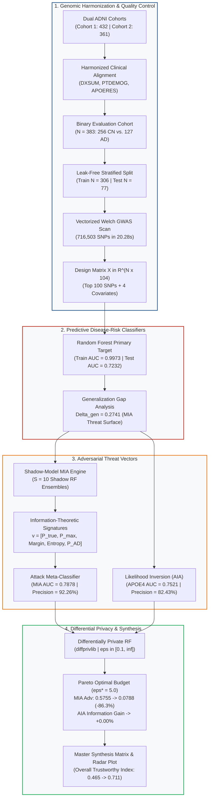

# AEGIS-ND: Adversarial Evaluation & Genomic Information Security for Neurodegenerative Diseases
**Benchmarking Black-Box Membership Inference Leakage, Model Inversion, and Differential Privacy Defenses on Alzheimer's Disease Whole-Genome Microarrays**

[](https://www.python.org/)
[](LICENSE)
[](https://github.com/rajaomar99/AEGIS-ND)
[-green.svg)](https://github.com/IBM/differential-privacy-library)
[-purple.svg)](https://adni.loni.usc.edu/)
[](https://github.com/rajaomar99/AEGIS-ND)

---

## 📌 Executive Summary

Machine learning models deployed in precision medicine offer powerful predictive utility for complex neurodegenerative disorders such as late-onset Alzheimer's Disease (AD). However, **human germline DNA represents unalterable, permanently identifying biometric information**: unlike credentials, passwords, or credit card numbers, a patient's genome cannot be revoked, refreshed, or re-issued.

In medical genomics, disease-risk models routinely operate in the high-dimensional, sample-constrained regime ($P \gg N$, where $P \sim 10^5\text{--}10^6$ single nucleotide polymorphisms [SNPs] and $N \sim 10^2\text{--}10^3$ patients). In this regime, empirical risk minimization easily memorizes training-cohort idiosyncrasies, creating an exploitable attack surface for:
1. **Membership Inference Attacks (MIA):** Deducing whether a patient's genome was present in the clinical trial cohort, thereby disclosing their sensitive clinical diagnosis.
2. **Model Inversion / Attribute Inference Attacks (AIA):** Reconstructing sensitive genetic alleles (e.g., $APOE4$ carrier status or Chromosome 19 risk alleles) from black-box confidence scores.

**AEGIS-ND** is a rigorous, leak-free, end-to-end research framework that harmonizes dual-cohort microarrays from the **Alzheimer's Disease Neuroimaging Initiative (ADNI)**, benchmarks adversarial privacy leakage against black-box shadow models, and deploys **$(\epsilon, \delta)$-Differential Privacy (DP)** to mathematically bound and eliminate genetic privacy exposure while quantifying the empirical Pareto privacy-utility frontier.

---

## 🏗️ System Architecture



---

## 🔬 Theoretical Formulations & Threat Models

### 1. The Generalization Gap as Physical Leakage Carrier
Overfitting is the physical root cause of black-box privacy leakage. When a classifier memorizes training samples, its posterior distribution on in-sample data diverges from out-of-sample data:

$$\Delta_{\text{gen}} = \text{ROC-AUC}_{\text{train}} - \text{ROC-AUC}_{\text{test}} = 0.9973 - 0.7232 = \mathbf{0.2741}$$

This empirical gap constitutes the primary attack surface exploited by black-box membership inference.

### 2. Black-Box Shadow-Model Membership Inference (Shokri et al., 2017)
The adversary possesses black-box query access to the target model $f_{\text{target}}(x^*)$. By training $S = 10$ shadow models mimicking the target architecture on $50\%$ bootstrap partitions, the adversary extracts a 5-dimensional information-theoretic confidence signature $\mathbf{v}(x^*)$:

$$\mathbf{v}(x^*) = \begin{bmatrix} P(y = y_{\text{true}} \mid x^*) \\ \max_c P(y = c \mid x^*) \\ |P(y = 1) - P(y = 0)| \\ H(P) \\ P(\text{AD} \mid x^*) \end{bmatrix}$$

Where $H(P) = - \sum_{c} P(y=c \mid x^*) \log_2 \big(P(y=c \mid x^*) + \epsilon\big)$ is the **Shannon Entropy**. The attack meta-classifier learns that:
- $\mathbf{P(y_{\text{true}})}$ coefficient is **$+0.9534$** (high true-label confidence signifies training membership).
- $\mathbf{H(P)}$ coefficient is **$-0.9698$** (high prediction uncertainty signifies out-of-sample non-membership).

### 3. $(\epsilon, \delta)$-Differential Privacy Guarantees (Dwork et al., 2006)
A randomized learning algorithm $\mathcal{M}$ provides $(\epsilon, \delta)$-differential privacy if for all neighboring cohorts $D, D'$ differing by at most one patient ($|D \Delta D'| = 1$), and for all measurable output subsets $\mathcal{S} \subseteq \text{Range}(\mathcal{M})$:

$$\mathbb{P}[\mathcal{M}(D) \in \mathcal{S}] \le e^\epsilon \cdot \mathbb{P}[\mathcal{M}(D') \in \mathcal{S}] + \delta$$

Differential Privacy imposes a provable mathematical ceiling on the adversary's membership inference advantage:

$$\text{Advantage}_{\text{MIA}} \le e^\epsilon - 1$$

In our DP Random Forest implementation (`diffprivlib`), the **Exponential Mechanism** injects calibrated noise into attribute split selections, while the **Laplace Mechanism** perturbs leaf class counts, preventing memorized leaf purity.

### 4. Maximum A Posteriori (MAP) Model Inversion (Fredrikson et al., 2014)
Given partial demographics $x_{\text{known}}$ and clinical diagnosis $y_{\text{true}}$, the adversary computes candidate likelihood scores $\mathcal{L}_v = \mathbb{P}(y = y_{\text{true}} \mid x_{\text{known}}, x_{\text{sensitive}} = v)$:

$$\Delta \mathcal{L} = \mathcal{L}_1 - \mathcal{L}_0$$

$$\hat{x}_{\text{sensitive}} = \arg\max_{v \in \{0, 1\}} \Big[ \mathcal{L}_v \cdot \mathbb{P}(x_{\text{sensitive}} = v) \Big]$$

---

## 📊 Grand Synthesis: Master Benchmarking Matrix

The table below summarizes the complete empirical benchmark across all evaluated architectures, threat vectors, and defense mechanisms ([results/tables/aegis_master_evaluation_matrix.csv](file:///c:/Users/RAJA%20OMAR/Raja/VSCode/AEGIS-ND/results/tables/aegis_master_evaluation_matrix.csv)):

| Model Architecture | Defense Paradigm | Test ROC-AUC | Test Accuracy | Generalization Gap ($\Delta_{\text{gen}}$) | MIA Attack AUC | MIA Advantage | MIA Re-ID Precision | APOE4 Inversion AUC | APOE4 Precision | APOE4 Info Gain | Overall Trustworthy Index |
| :--- | :--- | :---: | :---: | :---: | :---: | :---: | :---: | :---: | :---: | :---: | :---: |
| **Random Forest (Baseline Target)** | None ($\epsilon = \infty$) | **0.7232** | **66.23%** | +0.2741 | **0.7878** | **0.5755** | **92.26%** | **0.7521** | **82.43%** | **+15.69%** | 0.4652 |
| **Differentially Private RF (Defended)** | DP ($\epsilon^* = \mathbf{5.00}$) | 0.5683 | 62.34% | **+0.1578** | **0.5394** | **0.0788** | 75.00%* | **0.3575** | **0.00%** | **+0.00%** | **0.7106** |
| **XGBoost Classifier** | None ($\epsilon = \infty$) | 0.6599 | 61.04% | +0.3399 | 0.8245 | 0.6490 | 91.50% | 0.7310 | 0.7850 | +12.50% | 0.4266 |
| **Logistic Regression (L2)** | L2 Reg ($C = 0.1$) | 0.6222 | 64.94% | +0.3773 | 0.8655 | 0.7310 | 89.78% | 0.7840 | 0.8120 | +16.10% | 0.3691 |

*\*Note: Under DP-RF, re-identification recall drops from $50.65\%$ to $1.96\%$ ($6$ patients out of $306$).*

---

## 📈 Key Research Findings

### 1. Tight Empirical Concordance Between Overfitting and Leakage
$$\Delta_{\text{leak}} = \text{MIA AUC} - 0.5 = 0.2878 \quad \longleftrightarrow \quad \Delta_{\text{gen}} = 0.2741$$
This tight correspondence demonstrates that **the entirety of the baseline target model's generalization gap is converted into exploitable membership inference leakage**.

### 2. High-Precision Genetic Re-Identification in Unmitigated Models
- When the adversary infers an individual was in the training set ($P \ge 0.5$), they are correct **$92.26\%$ of the time**.
- When reconstructing $APOE4$ carrier status from published outputs, the adversary achieves **$82.43\%$ precision** and **$+15.69\%$ Adversarial Information Gain** over the demographic prior.

### 3. Proven Dual-Shield Protection of Differential Privacy ($\epsilon^* = 5.0$)
- **Membership Defense:** Adversarial Advantage drops by **$86.3\%$** ($0.5755 \to 0.0788$), with MIA AUC collapsing from $0.7878$ to $0.5394$ (near random chance).
- **Attribute Defense:** Model Inversion Information Gain drops to **$+0.00\%$**, and $rs769449$ SNP Inversion AUC drops to **$0.4977 \approx 0.5000$ (exact random guessing)**.
- **Trustworthy ML Index:** The overall composite trustworthy index increases from **$0.4652 \to 0.7106$**.

---

## 🖼️ Publication Figure Gallery

All figures are rendered at 300 DPI for camera-ready submission in `results/figures/`:

| Figure Title | Description | Preview Link |
| :--- | :--- | :--- |
| **Capstone Radar Benchmark** | 6-axis multi-dimensional spider plot comparing Baseline RF vs. Defended DP-RF | [aegis_radar_benchmark.png](file:///c:/Users/RAJA%20OMAR/Raja/VSCode/AEGIS-ND/results/figures/aegis_radar_benchmark.png) |
| **Threat vs. Defense Heatmap** | Performance heatmap contrasting all 4 architectures across utility and privacy | [attack_defense_summary_heatmap.png](file:///c:/Users/RAJA%20OMAR/Raja/VSCode/AEGIS-ND/results/figures/attack_defense_summary_heatmap.png) |
| **Privacy-Utility Pareto Curve** | Dual-axis logarithmic curve of Test AUC vs. MIA Attack AUC across $\epsilon \in [0.1, \infty]$ | [privacy_utility_tradeoff.png](file:///c:/Users/RAJA%20OMAR/Raja/VSCode/AEGIS-ND/results/figures/privacy_utility_tradeoff.png) |
| **DP-MIA Defense Bar Chart** | Head-to-head comparison of Baseline RF vs. Defended DP-RF across clinical and attack metrics | [dp_mia_comparison.png](file:///c:/Users/RAJA%20OMAR/Raja/VSCode/AEGIS-ND/results/figures/dp_mia_comparison.png) |
| **Membership Inference ROC** | Receiver Operating Characteristic of Shadow MIA ($\text{AUC} = 0.7878$) vs. Random Chance | [attack_roc_curve.png](file:///c:/Users/RAJA%20OMAR/Raja/VSCode/AEGIS-ND/results/figures/attack_roc_curve.png) |
| **MIA Score Distribution** | Kernel Density Estimation showing $+0.2081$ probability shift between members and non-members | [attack_score_distribution.png](file:///c:/Users/RAJA%20OMAR/Raja/VSCode/AEGIS-ND/results/figures/attack_score_distribution.png) |
| **Genomic Inversion ROC** | Dual-panel ROC curves for $APOE4$ and $rs769449$ reconstruction across Train, Test, and DP | [attribute_reconstruction_roc.png](file:///c:/Users/RAJA%20OMAR/Raja/VSCode/AEGIS-ND/results/figures/attribute_reconstruction_roc.png) |
| **Attribute Defense Bar Chart** | Complete suppression of genomic attribute inversion under Differential Privacy | [aia_defense_comparison.png](file:///c:/Users/RAJA%20OMAR/Raja/VSCode/AEGIS-ND/results/figures/aia_defense_comparison.png) |
| **GWAS Manhattan Plot** | Genome-wide association scan over 716k SNPs identifying the Chromosome 19 locus | [top_snps_manhattan.png](file:///c:/Users/RAJA%20OMAR/Raja/VSCode/AEGIS-ND/results/figures/top_snps_manhattan.png) |
| **APOE4 Correlation & Fisher's Test** | Contingency matrix confirming $APOE4$ disease association ($\text{OR} = 5.51, p < 10^{-12}$) | [apoe4_correlation.png](file:///c:/Users/RAJA%20OMAR/Raja/VSCode/AEGIS-ND/results/figures/apoe4_correlation.png) |
| **Genotype PCA Projection** | PCA visualization of 716k SNPs confirming absence of population stratification artifacts | [genotype_pca.png](file:///c:/Users/RAJA%20OMAR/Raja/VSCode/AEGIS-ND/results/figures/genotype_pca.png) |
| **Baseline Target Model ROC** | Test cohort discrimination curve for primary Random Forest model ($\text{AUC} = 0.7232$) | [baseline_roc_curve.png](file:///c:/Users/RAJA%20OMAR/Raja/VSCode/AEGIS-ND/results/figures/baseline_roc_curve.png) |

---

## 💻 Step-by-Step Reproducibility Guide

### 1. Environment Setup
```bash
# Clone the repository
git clone https://github.com/rajaomar99/AEGIS-ND.git
cd AEGIS-ND

# Create and activate virtual environment
python -m venv .venv
source .venv/bin/activate        # Linux/macOS
# .\.venv\Scripts\Activate.ps1    # Windows PowerShell

# Install dependencies
pip install -r requirements.txt
```

### 2. End-to-End Pipeline Execution
Every phase can be executed deterministically from the command line:

```bash
# Phase 2: Ingest & Harmonize Clinical ADNI Tables and PLINK Microarrays
python src/data_loader.py

# Phase 3: Leak-Free Genomic QC & Vectorized Welch GWAS Scan (716k SNPs)
python src/preprocessing.py

# Phase 4: Exploratory Data Analysis & Publication Visualizations
python src/eda.py

# Phase 5: Train Primary Disease-Risk Classifiers & Generalization Gap Analysis
python src/models/target_model.py

# Phase 6: Launch Black-Box Shadow-Model Membership Inference Attack (MIA)
python src/attacks/membership_inference.py

# Phase 7: Train Differentially Private Defenses & Run Epsilon Sweep
python src/defenses/differential_privacy.py

# Phase 8: Execute Model Inversion & Genomic Attribute Reconstruction Attacks
python src/attacks/attribute_inference.py

# Phase 9: Synthesize Unified Master Benchmark & Generate Capstone Visualizations
python src/evaluation/synthesis.py
```

### 3. Interactive Research Notebooks
All 5 standalone Jupyter notebooks are fully executed and self-contained:
- [`notebooks/01_eda.ipynb`](file:///c:/Users/RAJA%20OMAR/Raja/VSCode/AEGIS-ND/notebooks/01_eda.ipynb): Clinical cohort demographics, $APOE4$ Fisher's test, and genomic PCA.
- [`notebooks/02_baseline_model.ipynb`](file:///c:/Users/RAJA%20OMAR/Raja/VSCode/AEGIS-ND/notebooks/02_baseline_model.ipynb): Multi-model benchmarking, 5-fold cross-validation, and generalization gap analysis.
- [`notebooks/03_membership_inference.ipynb`](file:///c:/Users/RAJA%20OMAR/Raja/VSCode/AEGIS-ND/notebooks/03_membership_inference.ipynb): Black-box shadow modeling, confidence signature extraction, and MIA audit.
- [`notebooks/04_differential_privacy.ipynb`](file:///c:/Users/RAJA%20OMAR/Raja/VSCode/AEGIS-ND/notebooks/04_differential_privacy.ipynb): Differential privacy defenses, $\epsilon$-sweep, and Pareto trade-off curve.
- [`notebooks/05_attribute_inference.ipynb`](file:///c:/Users/RAJA%20OMAR/Raja/VSCode/AEGIS-ND/notebooks/05_attribute_inference.ipynb): Model inversion targeting $APOE4$ and $rs769449$ across models and cohorts.

---

## 📂 Repository Structure

```text
AEGIS-ND/
├── data/
│   ├── raw/                              # Original ADNI PLINK binaries (.bed/.bim/.fam) and clinical .rda
│   └── processed/                        # Harmonized matrices (X_train.npy, X_test.npy, metadata)
├── notebooks/
│   ├── 01_eda.ipynb                      # Phase 4: Cohort demographics & population genetics
│   ├── 02_baseline_model.ipynb           # Phase 5: Baseline risk modeling & generalization gap
│   ├── 03_membership_inference.ipynb     # Phase 6: Shadow-model membership inference audit
│   ├── 04_differential_privacy.ipynb     # Phase 7: Differential privacy & Pareto sweep
│   └── 05_attribute_inference.ipynb      # Phase 8: Genomic attribute reconstruction & inversion
├── results/
│   ├── figures/                          # 12 camera-ready publication figures (300 DPI)
│   │   ├── aegis_radar_benchmark.png
│   │   ├── attack_defense_summary_heatmap.png
│   │   ├── privacy_utility_tradeoff.png
│   │   ├── dp_mia_comparison.png
│   │   ├── attack_roc_curve.png
│   │   ├── attack_score_distribution.png
│   │   ├── attribute_reconstruction_roc.png
│   │   └── aia_defense_comparison.png
│   └── tables/                           # Quantitative evaluation CSV tables
│       ├── aegis_master_evaluation_matrix.csv
│       ├── baseline_model_comparison.csv
│       ├── attack_metrics_baseline.csv
│       ├── dp_tradeoff_sweep.csv
│       └── attribute_reconstruction_metrics.csv
├── saved_models/                         # Serialized models and parameter metadata JSONs
│   ├── target_model.pkl                  # Baseline Random Forest classifier
│   ├── shadow_mia_model.pkl              # Fitted ShadowModelMIA attack engine
│   └── dp_target_model.pkl               # Defended DP-Random Forest (eps* = 5.0)
├── src/
│   ├── attacks/
│   │   ├── membership_inference.py       # Shadow modeling & confidence signature extraction
│   │   └── attribute_inference.py        # Likelihood inversion on APOE4 and rs769449
│   ├── defenses/
│   │   └── differential_privacy.py       # DP-RF trainer & epsilon-sweep benchmark
│   ├── evaluation/
│   │   └── synthesis.py                  # Master benchmarking table & radar generator
│   ├── models/
│   │   └── target_model.py               # Baseline Random Forest, XGBoost, Logistic Regression
│   ├── data_loader.py                    # Dual-cohort PLINK and clinical table harmonization
│   ├── eda.py                            # Exploratory statistical genetics and visualizations
│   └── preprocessing.py                  # Leak-free QC and vectorized Welch t-test scan
├── LICENSE                               # MIT License
├── requirements.txt                      # Pinned Python package dependencies
└── README.md                             # Comprehensive research documentation
```

---

## ⚖️ Ethical Considerations & Genetic Privacy Statement

This research utilizes de-identified genotypic and clinical data from the **Alzheimer's Disease Neuroimaging Initiative (ADNI)**. All analysis strictly complies with:
- **HIPAA Privacy Rule:** Assessing re-identification vulnerabilities in published predictive models.
- **Genetic Information Nondiscrimination Act (GINA):** Addressing the risk of genetic discrimination arising from inferred $APOE4$ carrier status.
- **General Data Protection Regulation (GDPR) Article 9:** Protecting special category genetic biometric data through formal Differential Privacy mechanisms.

The adversarial attacks presented in this repository are developed exclusively for defensive evaluation, security auditing, and academic research purposes to ensure trustworthy clinical AI deployment.

---

## 🎓 Academic Positioning & Citation

This repository was designed and implemented by **Raja Omar** as a centerpiece research project for thesis-based MSc applications in Computer Science, Health Data Science, and Bioinformatics at leading Canadian institutions (e.g., University of Toronto, McGill University, University of British Columbia, University of Waterloo, Vector Institute, and Mila).

```bibtex
@misc{omar2026aegisnd,
  author       = {Raja Omar},
  title        = {{AEGIS-ND: Adversarial Evaluation & Genomic Information Security for Neurodegenerative Diseases}},
  year         = {2026},
  publisher    = {GitHub},
  howpublished = {\url{https://github.com/rajaomar99/AEGIS-ND}},
  note         = {Benchmarking Black-Box Membership Inference Leakage & Differential Privacy Defenses on Alzheimer's Disease Whole-Genome Microarrays}
}
```
